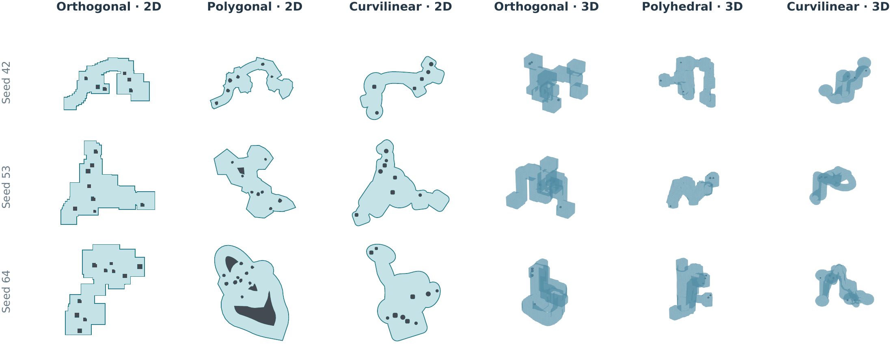

# Dungeon and Visibility World Generator

Reproducible 2D/3D dungeon environments and line-of-sight data for
**vision-based online tasks**, including exploration, coverage and observer
deployment. The world supplies simulation ground truth; your task algorithm
chooses observations and retains the information it has seen.



## Quick start

Use Python 3.11 and a Rust toolchain:

```sh
git clone https://github.com/EdwinMeriaux/Dungeon_and_Visibility_World_Generator.git
cd Dungeon_and_Visibility_World_Generator
python3.11 -m venv .venv
source .venv/bin/activate
python -m pip install -r requirements-lock.txt
cargo build --locked --release --manifest-path rust/visibility_engine/Cargo.toml
```

Generate a world, compute continuous and discrete visibility, validate it,
and render previews:

```sh
python scripts/run_pipeline.py \
  --config configs/showcase/2d_polygonal_1.json \
  --output outputs/polygonal_example --stage all
```

For a 3D example, use `configs/distributions/3d_stable_elevations.json` with
a new output folder. Use `--stage generate` for geometry and occupancy only.
Other stages are `visibility`, `validate` and `render`. Existing sensing
results are protected; use a **fresh output folder** for each experiment.
Run `python scripts/run_pipeline.py --help` for all options.

## Worlds and controls

Six classes are available: orthogonal, polygonal and curvilinear in 2D;
orthogonal, polyhedral and curvilinear in 3D. Curved 2D walls are recorded
tessellations; curved 3D worlds use ellipsoids and spherical passage sweeps.

The six construction families are **scattered rooms, room clusters, caverns,
winding passages, branches and irregular loops**. Some place rooms and
connect them; others grow passages or loops and attach rooms.

Start with a complete configuration from [configs/showcase](configs/showcase)
or [configs/distributions](configs/distributions). Exposed numeric controls
accept fixed values, uniform ranges or named distributions. For example:

```json
"rooms": {
  "count": [7, 10],
  "width": [6, 9],
  "length": [7, 11],
  "placement": {
    "type": "gaussian",
    "mean": [25, 25],
    "std": [6, 6]
  }
}
```

Scalar laws include `fixed`, `uniform`, `uniform_int`, `normal`, `gaussian`,
`truncated_normal`, `lognormal`, `exponential`, `poisson`, `beta`,
`categorical` and `mixture`. Integer Gaussian controls round to the nearest
integer, with half ties away from zero. Spatial placement also supports
independent coordinates, boxes, covariance matrices and mixtures.
The [parameter catalog](configs/layout_parameter_catalog.json) lists
family-specific controls. Fitting and rejection affect accepted distributions;
requested and achieved room counts can differ in passage-first families.

## Geometry, visibility and saved data

The generator builds continuous free space, then derives a conservative
occupancy grid. Arrays use **x, y[, z] axis order**, with `True` for free
space. A 2D cell must lie wholly inside the polygon; 3D voxels use a sufficient
whole-voxel clearance certificate. Extent and grid resolution are separate.

Visibility checks the straight segment from observer to target against
continuous walls/solids or blocked grid cells. Discrete targets are **all free
cell or voxel centers**. Matched queries use identical coordinates in both
representations. Conservative grid walls can obstruct a segment that is clear
in the continuous world. Finite-target coverage does not prove complete
continuous coverage.

| Output | Contents |
| --- | --- |
| `configuration.json`, `metadata.json`, `layout.json` | Settings, sampled construction and source hashes |
| `geometry.geojson` or `solid.json`, `free.npy` | Continuous world and Boolean occupancy |
| `*targets.npy`, `*observers.npy` | Query coordinates |
| `visibility_*_input.json` | Replayable world, coordinates and sensor settings |
| `visibility_*.csr`, `visibility_*.npz` | Sparse observer-by-target visibility matrices |
| `validation.json`, `figures/` | Consistency checks and previews |

Replay a generated query:

```sh
rust/visibility_engine/target/release/visibility_engine \
  --input outputs/polygonal_example/visibility_continuous_input.json \
  --output outputs/replayed_visibility --threads 2
```

The same code, configuration, seed and numerical environment reproduce the
world. Different library builds can change floating-point geometry.
`junction_elevation_rule: "lowest_index"` stabilizes near-equal 3D room-distance
ties. `python/wgv/hierarchy.py` measures quadtree/octree node counts under
recorded grid conventions; it does not accelerate visibility.

## Code and checks

- `python/wgv/`: generation, distributions, solids, sampling, visibility and validation.
- `rust/visibility_engine/`: standalone visibility engine and Cargo lockfile.
- `configs/`: small configuration examples and the parameter catalog.
- `vendor/non_orthogonal_worlds/`: two required layout helpers.
- `scripts/run_pipeline.py`, `tests/`: entry point and tests using fresh worlds.

```sh
python -m pytest tests -q
cargo test --locked --manifest-path rust/visibility_engine/Cargo.toml
```

[GitHub Actions](.github/workflows/ci.yml) builds the engine, runs tests and
checks fresh 2D/3D pipelines. Generated outputs, manuscripts, Overleaf bundles
and research archives are excluded from Git.
